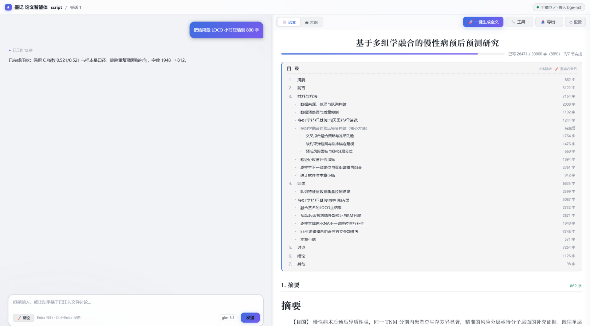
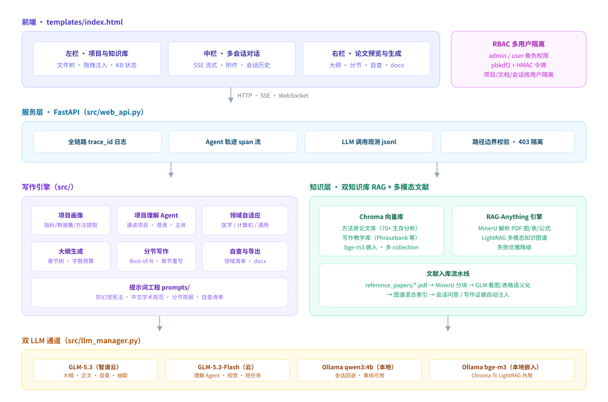
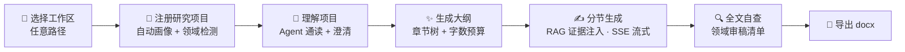

<div align="center">

# 墨记 · 论文写作智能体

**通用于任意研究项目的中文论文写作 Agent —— 从「读懂你的项目」到「产出全稿」的全流程自动化**

[](https://www.python.org/)
[](https://fastapi.tiangolo.com/)
[](https://python.langchain.com/)
[](https://www.trychroma.com/)
[](https://github.com/HKUDS/RAG-Anything)
[](LICENSE)

*不绑定任何工作区 · 按领域自适应人设与模板 · 多用户 RBAC 权限隔离 · 全链路可观测*



*三栏工作台：左栏项目与知识库 · 中栏多会话对话（文件拖拽注入） · 右栏大纲/分节写作/自查/导出（截图中论文内容为演示数据）*

</div>

## 🖥️ 系统架构



## ✨ 核心特性

- **🔬 项目理解 Agent**：通读你的研究项目代码与结果，理清研究顺序/核心脚本/结果图表，弹窗澄清模糊处，生成《研究项目主体》注入全部写作任务
- **🧭 领域自适应**：注册项目时自动检测论文领域——医学科研（TRIPOD/C指数）、计算机/工程（消融实验）、通用 IMRAD，自动切换写作人设、语言规范、章节模板与自查清单
- **📊 项目画像**：扫描脚本/结果目录，自动提取研究阶段、方法清单（含代码证据行号）、数据集（GEO/TCGA/ImageNet/COCO…）、关键结果数字（C指数/HR/F1/mAP/IoU/PSNR…）
- **📚 双知识库 RAG**：方法原论文知识库（PubMed/Crossref/PMC/arXiv 自动抓取，内置医学生存分析 70 法）+ 写作教学知识库（Academic Phrasebank / Nature 摘要公式 / B站教学视频字幕）
- **🖼️ RAG-Anything 多模态文献引擎**：参考文献 PDF 经 MinerU 解析（图/表/公式/文本分块）→ GLM 看图写描述 → LightRAG 多模态知识图谱，会话与写作自动检索图表级证据
- **📝 全流程写作**：大纲生成（章节树 + 证据指针 + 字数预算）→ 分节流式生成 → 单节重生成 → Best-of-N → 按领域自查清单模拟审稿 → 一键导出 docx（图表/公式/三线表）
- **🔐 多用户 RBAC**：admin/user 角色，项目、文档、会话、参考论文按用户隔离，pbkdf2 密码哈希 + HMAC 令牌，跨用户访问一律 403
- **🔭 全链路可观测**：同一 `trace_id` 贯穿 HTTP→API→业务→LLM→后台线程，Agent 执行轨迹 span 流，LLM 调用观测（成本与性能分析数据底座）

## 🚀 快速开始

```bash
# 1) 克隆并安装依赖（Python 3.10+）
git clone https://github.com/hlh-syd/moji-paper-agent.git
cd paper-writing-agent
python -m venv .venv && .venv/Scripts/activate      # Windows
# source .venv/bin/activate                          # macOS/Linux
pip install -r requirements.txt

# 2) 配置密钥
copy .env.example .env        # 编辑 .env，填入 ZHIPU_API_KEY（https://open.bigmodel.cn/）

# 3) 准备本地模型（需 Ollama：https://ollama.com）
ollama pull bge-m3              # 嵌入模型（Chroma 与 LightRAG 共用）
ollama pull qwen3:4b-instruct   # 本地小模型（会话回退，可选）

# 4) 构建知识库（联网抓取文献，方法库约 5-10 分钟）
python -X utf8 main.py --build-kb all        # 或 methods / writing 二选一

# 5) 启动
python -X utf8 main.py --mode web            # 浏览器打开 http://localhost:8000
```

> Windows 有一键脚本：`启动论文智能体.bat` / `停止论文智能体.bat`（自检环境 → 后台启动 → 健康检查 → 打开浏览器）。

## 📖 使用流程



1. **首次启动**引导你设置工作区根目录（任意路径，之后可随时切换），会话与生成物自动跟随
2. **左栏**点击研究项目完成注册（自动构建画像并检测领域）；可手动改选**领域**与**结构模板**（`chinese_journal` / `cs_paper` / `thesis_proposal`）
3. （推荐）点 **🧠 理解项目**：生成《研究项目主体》注入全部写作任务
4. **右栏**调整总字数 → **✨ 生成大纲**（章节树含要点/证据指针/目标字数）
5. （可选）从**文件树拖拽/右键**把脚本、报告加入**中栏会话**讨论；**🔬 深化画像**让视觉模型逐图写描述
6. **右栏**逐节点「生成本节」，不满意可填要求后「重新生成」
7. 全文完成后 **🔍 全文自查**（清单随领域走）→ **📄 导出 docx**

## 🧩 可插拔设计

**领域包**：领域差异收敛在 `src/domain.py`——每个领域包声明写作/审稿人设、语言规范文件、章节模板、分节简报、检索词与自查清单。新增领域 = `DOMAINS` 加一项 + `src/prompts/` 放对应文件。领域判定优先级：**界面手动指定 > 画像 `domain` 字段 > 自动检测**。

**方法注册表**：全局注册表（`ingestion/method_registry.yaml`）之外，项目内放 `method_registry.yaml` 即可定义自己的方法→原论文映射（用于方法匹配与文献引用），没有注册表也不影响写作。

**提示词工程**：`src/prompts/` 全部外置——防幻觉宪法（不编造/占位符/claim-evidence 映射）、中文学术语言规范（GB/T 7714）、各领域章节叙事骨架与分节简报、自查清单（通用 + 医学 TRIPOD）。

## 📡 双 LLM 通道

| 通道 | 模型 | 用途 |
|---|---|---|
| 主（云端） | 智谱 GLM-5.3 | 大纲生成、正文写作、自查、实体/关系抽取 |
| 辅（云端） | GLM-5.3-Flash | 项目理解 Agent、视觉看图、轻量任务 |
| 本地 | Ollama qwen3:4b-instruct | 会话聊天回退、离线可用 |
| 嵌入 | Ollama bge-m3 | Chroma 知识库与 LightRAG 图谱共用 |

主模型未配置时大纲/正文生成不可用，会话聊天自动回退本地小模型——**云端与本地的组合可按需替换为任何 OpenAI 兼容端点**。

## 📚 RAG-Anything 多模态文献引擎

```
reference_papers/*.pdf
  → MinerU 解析（文本/图像/表格/公式分块，保留层级）
  → 多模态分析（GLM 看图写描述、表格语义化、LaTeX 解析）
  → LightRAG 多模态知识图谱（文本实体 + 图表实体混合索引）
  → 检索：会话问答 + 分节写作证据注入（自动，失败优雅降级）
```

- 上传参考文献 PDF 后自动后台解析入库；`POST /api/rag/ingest` 手动批量，`GET /api/rag/status` 查进度，`POST /api/rag/query` 图谱问答
- 依赖：`pip install raganything "mineru[core]>=3.4.1,<4"`（CUDA 加速先装 cu126 torch）；MinerU 模型首次运行自动从 modelscope 下载
- ⚠️ mineru 必须用 3.4.x——4.x CLI 与 raganything 1.4.1 不兼容；引擎未装时主服务照常运行（相关功能自动降级）

## 🔭 可观测性

- **trace 贯穿**：每请求自动生成 8 位 `trace_id`（或继承 `X-Request-ID`），日志自动附加 `[trace_id 用户]`，响应头回传
- **Agent 轨迹**：`logs/agent_trace.jsonl` 每行一个 span（query/node/tool/llm/error），含入参/出参 JSON 与耗时，`span()` 上下文管理器一行接入新节点
- **LLM 调用观测**：LangChain callback 自动记录每次模型调用到 `logs/llm_calls.jsonl`（用途/耗时/输出量/成败）
- **工程化细节**：纯 ASGI 中间件访问日志（避开 BaseHTTPMiddleware 断 contextvar 的坑）、10MB×5 轮转、`format: json` 一键接 ELK/Loki、高噪声库统一降 WARNING

## 🗂️ 目录结构

```
paper-writing-agent/
├── main.py                  # 入口：--mode web/api、--build-kb
├── config.yaml              # 双通道模型/向量库/结构模板/工作区配置
├── .env.example             # 密钥模板（ZHIPU_API_KEY 等）
├── ingestion/               # 知识库构建：文献抓取入库 + 方法注册表 + B站字幕
├── src/
│   ├── web_api.py           # FastAPI 全部路由
│   ├── auth.py              # RBAC：pbkdf2 + HMAC 令牌 + 用户管理
│   ├── observability.py     # 全链路日志/trace/LLM 调用观测
│   ├── domain.py            # 领域包注册表 + 自动检测
│   ├── llm_manager.py       # 双通道 LLM 管理
│   ├── rag_anything_engine.py  # 多模态文献引擎
│   ├── vector_store.py      # 多 collection Chroma 封装
│   ├── project_indexer.py   # 项目画像提取器
│   ├── project_analyst.py   # 项目理解 Agent
│   ├── outline_generator.py # 大纲生成 + 字数预估
│   ├── section_writer.py    # 分节写作/重生成/自查/docx 导出
│   ├── fact_guard.py        # 事实防线：claim-evidence 校验
│   ├── reference_manager.py # 参考文献管理
│   ├── vision_agent.py      # 视觉看图（深化画像/图表分析）
│   └── prompts/             # 提示词工程（generic/cs/medical 领域变体）
├── templates/index.html     # 三栏前端
├── static/                  # styles.css + js/app.js
├── tools/                   # 在线 AIGC 检测
├── docs/                    # 评测方案与配图
├── distill_humanize/        # 附：QLoRA 微调「人味化」小模型实验（脚本，权重不入库）
├── 启动论文智能体.bat        # Windows 一键启动/停止
└── Dockerfile / docker-compose.yml
```

## 🔌 API 摘要

```
GET  /api/domains                    领域包清单
GET  /api/projects                   候选 + 已注册项目
POST /api/projects/register          {name, path, domain?} → 构建画像
GET  /api/kb/status                  知识库状态
POST /api/kb/build/{methods|writing|all}
GET  /api/rag/status                 RAG-Anything 引擎状态/进度
POST /api/rag/ingest                 多模态入库（缺省批量后台）
POST /api/rag/query                  图谱问答（含图表/公式/表格）
GET  /api/outline/templates          结构模板
POST /api/outline/generate           生成大纲（LLM）
GET/PUT /api/outline/{name}          读取/保存大纲
POST /api/sections/regenerate        单节重生成（SSE 流式）
POST /api/sections/self_review       全文自查（清单随领域）
POST /api/outline/export/docx        导出 Word
POST /api/chat/stream                会话聊天（SSE，支持附件）
WS   /api/ws                         {type: chat|get_system_info}
```

## 🧬 附：人味化小模型微调实验

`distill_humanize/` 是一条独立的 QLoRA → GGUF 流水线：用主模型蒸馏高分改写数据，QLoRA 微调 9B 小模型去「AI 腔」，导出 GGUF 供 Ollama 本地推理（`train_qlora.py` → `merge_export.py` → `to_gguf.md`，支持 P100 fp16 / 4060 本地 / 云 GPU 三种执行路径，云 GPU 经 `_cloud_ssh.py` 远程执行）。模型权重与数据集不入库。

## ⚠️ 已知边界

- B站 AI 字幕多数需登录态：`writing_sources.yaml` 中 `cookie_from_browser` 设为 `"chrome"`/`"edge"` 可借用浏览器 Cookie 提高字幕获取率，无字幕视频自动跳过
- 全局方法注册表当前内置医学生存分析方法；其他领域可放项目级 `method_registry.yaml` 或贡献新领域包
- 书籍类材料只收录公开页面，不抓盗版全文
- **Coding Plan 账号必须使用专用端点** `https://open.bigmodel.cn/api/coding/paas/v4/`；误用普通端点会报 `1113 余额不足`

## 🤝 贡献

欢迎 Issue 与 PR！新增领域包、方法注册表、写作知识库来源都是高价值贡献点。

## 📄 License

[MIT](LICENSE) © 2026
